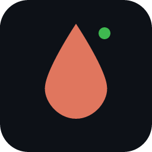
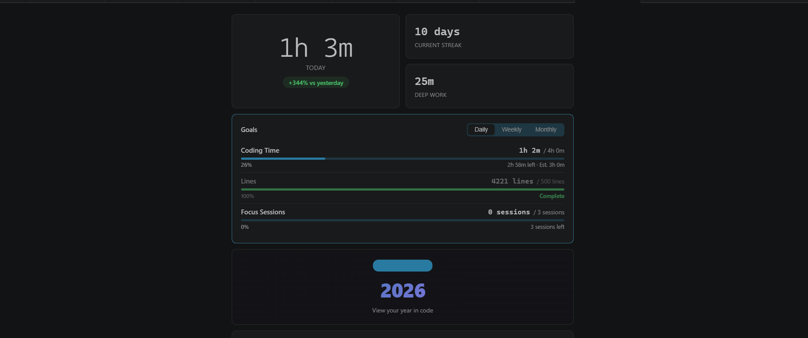
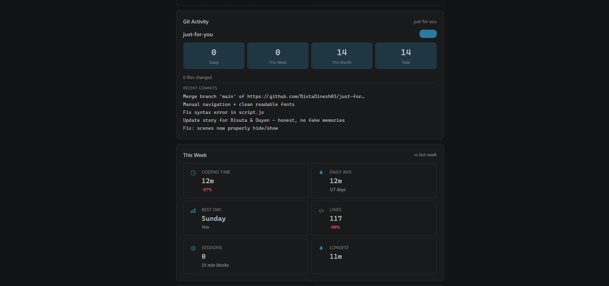
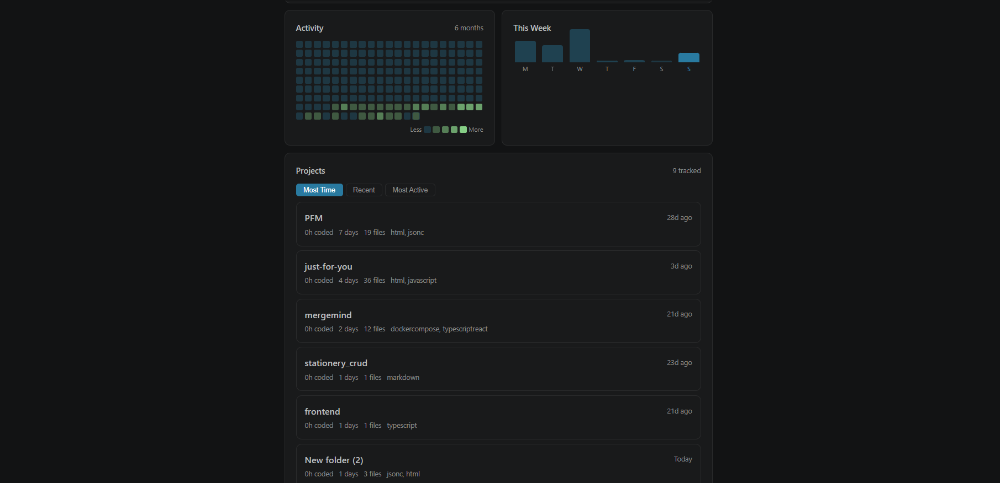
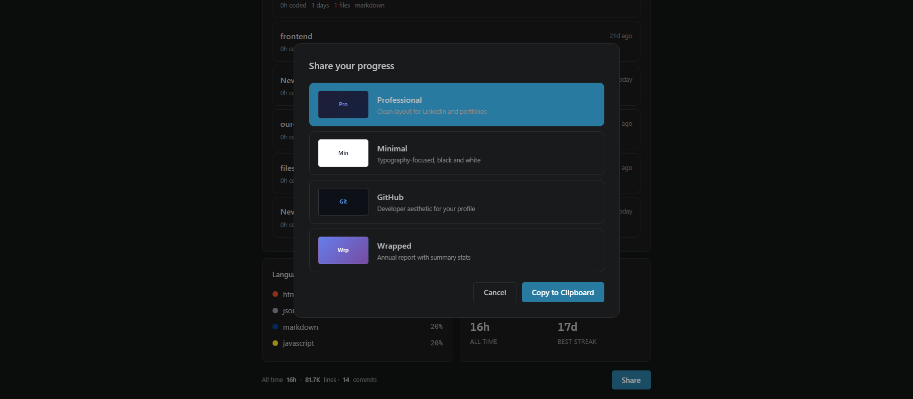

  

<h1 align="center">DevPulse</h1>

  <strong>See your coding time. Keep your data. No account required.</strong>

  Local-first coding activity tracker for VS Code.

  <a href="https://marketplace.visualstudio.com/items?itemName=bistadev.devpulse-code">
    <strong>➜ Install from Marketplace</strong>
  </a>

  
  
  

---

DevPulse automatically tracks your coding time, activity, and progress—right inside VS Code. See your streaks, goals, projects, and language breakdown from a beautiful dashboard. All data stays on your machine. No account. No telemetry. No external sync.

**Perfect for developers who want to understand their coding habits without relying on cloud services.**

---

## Dashboard

See today's coding time, current streak, deep work sessions, and progress on your daily goals. The Year in Code banner gives quick access to your annual summary.

---

## Git and Weekly Analytics

View commits from today, this week, this month, and all time alongside weekly coding statistics. See total time, daily average, best day, lines, sessions, and longest session in one place.

---

## Coding Activity and Projects

The activity heatmap shows your coding consistency over time. Project cards break down hours, files, and languages per workspace, so you know where your time went.

---

## Languages and Overview

See your language breakdown with percentages and color bars. The overview panel summarizes lines today, saves, total coding time, and best streak.

---

## Share Your Progress

Create a styled summary of your coding activity. Choose from Professional, Minimal, GitHub, or Wrapped templates and copy the result to your clipboard.

---

## Features

- **Automatic time tracking** – Runs in the background; no manual entry needed
- **Streaks and consistency** – Track your coding streaks to stay motivated
- **Goals** – Set daily, weekly, and monthly targets and monitor progress
- **Project breakdown** – See exactly where your time goes across workspaces
- **Git integration** – Commits tracked alongside your coding time
- **Activity heatmap** – Visualize your coding consistency at a glance
- **Weekly and monthly analytics** – Detailed time breakdowns and statistics
- **Language statistics** – Understand your programming language distribution
- **Wrapped summaries** – Create shareable annual and monthly reports
- **Export data** – Download everything as JSON anytime
- **Works offline** – No internet required; all tracking happens locally

---

## Privacy First

DevPulse keeps your coding data on your machine.

- No account required
- Data stored locally
- No telemetry
- Works offline
- Export your data anytime

---

## Installation

1. Open VS Code
2. Go to Extensions (`Ctrl+Shift+X` / `Cmd+Shift+X`)
3. Search for `DevPulse`
4. Click **Install**

Or [install directly from the VS Code Marketplace](https://marketplace.visualstudio.com/items?itemName=bistadev.devpulse-code).

---

## Commands

| Command | Description |
|---------|-------------|
| `DevPulse: Show Dashboard` | Open the main dashboard |
| `DevPulse: Open Yearly Wrapped` | View your annual report |
| `DevPulse: Open Monthly Wrapped` | View your monthly report |
| `DevPulse: Copy Share Card` | Generate and copy a shareable card |
| `DevPulse: Export Data` | Export all tracking data as JSON |

---

## FAQ

**Is DevPulse free?**  
Yes. DevPulse is completely free and open-source under the MIT license.

**Does DevPulse require an account?**  
No. It starts tracking immediately after installation with no signup, login, or API key needed.

**Is DevPulse a WakaTime alternative?**  
Yes. DevPulse is a local-first coding tracker for developers who prefer their data stored locally instead of on cloud servers.

**Where is my data stored?**  
All data is stored locally in your VS Code settings directory. Use `DevPulse: Export Data` to download it anytime.

**Does DevPulse work offline?**  
Yes. DevPulse requires no internet connection and tracks your coding time completely offline.

**Can I share my progress?**  
Yes. Use `DevPulse: Copy Share Card` to generate a styled summary with Professional, Minimal, GitHub, or Wrapped templates.

---

## Open Source

DevPulse is open-source software licensed under the MIT license.

- [View the source code](https://github.com/bistadev/devpulse)
- [Report issues or suggest features](https://github.com/bistadev/devpulse/issues)
- [Contribute](https://github.com/bistadev/devpulse)

---

  <strong><a href="https://marketplace.visualstudio.com/items?itemName=bistadev.devpulse-code">➜ Install DevPulse Now</a></strong>

---

## License

MIT – See [LICENSE](LICENSE) for details.